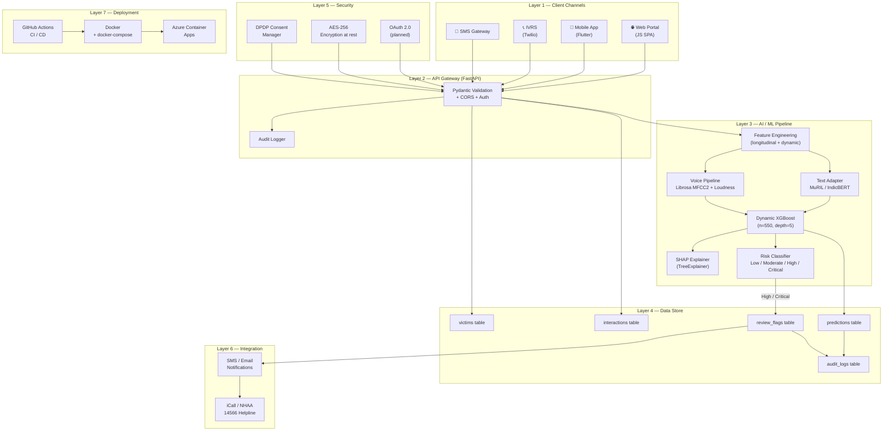

# System Architecture — SurakshaMind

**AI-Powered Dynamic Mental Health Monitoring System**  
Problem Statement 26094 · Ministry of Social Justice & Empowerment · SIH 2026

---

## 7-Layer Architecture

| Layer | Components | Responsibility |
|---|---|---|
| **1. Client** | Web SPA (JS), Flutter mobile, IVRS gateway, SMS handler | Multi-channel victim check-in; consent collection; result display |
| **2. API Gateway** | FastAPI, CORS middleware, Pydantic validation, optional API-key auth | Request validation, rate limiting, routing, audit logging |
| **3. AI / ML** | Feature engineering, Dynamic XGBoost, SHAP explainer, text adapter | Distress score prediction, risk classification, explainability |
| **4. Data** | SQLite (demo) / PostgreSQL (prod), SQLAlchemy ORM | Victim profiles, interaction history, predictions, review flags, audit logs |
| **5. Security** | OAuth 2.0 (planned), AES-256 at rest, DPDP consent manager, audit trail | Identity, access control, data protection, compliance |
| **6. Integration** | Twilio IVRS/SMS (planned), MuRIL/IndicBERT NLP, Librosa voice pipeline | Multi-modal input processing, regional language support |
| **7. Deployment** | Docker, docker-compose, Azure Container Apps, GitHub Actions CI | Reproducible builds, horizontal scaling, monitoring |

---

## Architecture Diagram



> ASCII fallback (for environments without Mermaid rendering):

```
┌─────────────────────────────────────────────────────────────┐
│  CLIENT CHANNELS                                             │
│  Web SPA  ·  Flutter App  ·  IVRS (Twilio)  ·  SMS          │
└───────────────────────┬─────────────────────────────────────┘
                        │ HTTPS / REST
┌───────────────────────▼─────────────────────────────────────┐
│  API GATEWAY  (FastAPI)                                      │
│  Pydantic validation · CORS · Optional API-key auth          │
│  Audit logger → audit_logs table                             │
└──────┬─────────────────────────────┬────────────────────────┘
       │                             │
┌──────▼──────────────┐   ┌──────────▼──────────────────────┐
│  AI / ML PIPELINE    │   │  DATA STORE (SQLite / PostgreSQL)│
│  ① Feature Eng.      │   │  victims · interactions          │
│  ② MuRIL NLP         │   │  predictions · review_flags      │
│  ③ Librosa Voice     │   │  audit_logs                      │
│  ④ Dynamic XGBoost   │   └──────────────────────────────────┘
│  ⑤ SHAP Explainer    │
│  ⑥ Risk Classifier   │
└──────┬──────────────┘
       │ High / Critical
┌──────▼──────────────────────────────────────────────────────┐
│  HUMAN REVIEW QUEUE                                          │
│  Counsellor Dashboard · Alert Panel · Acknowledge button     │
└──────┬──────────────────────────────────────────────────────┘
       │ Notification
┌──────▼──────────────────────────────────────────────────────┐
│  INTEGRATION  (planned)                                      │
│  SMS / Email · iCall 9152987821 · NHAA 14566 Helpline        │
└─────────────────────────────────────────────────────────────┘
```

---

## Data Flow: Check-in → Reassess

```
Victim submits check-in (text / voice / IVRS)
        ↓
[1] Input validation (Pydantic schema, 27 fields)
        ↓
[2] Feature engineering
    • Raw structured features (16 numeric + 8 categorical)
    • Longitudinal history features (9 dynamic):
      distress_delta, historical_mean, recent_mean,
      distress_momentum, fear/sadness/voice/engagement change
    • (Optional) Text embeddings via MuRIL
    • (Optional) Voice: MFCC2 + Loudness via Librosa
        ↓
[3] Dynamic XGBoost inference
    → predicted_next_distress_score (0–100)
        ↓
[4] Risk classification
    Low (<40) · Moderate (40–65) · High (65–80) · Critical (≥80)
        ↓
[5] SHAP explanation (TreeExplainer)
    → top-5 feature attributions per prediction
        ↓
[6] Persist: Prediction row + AuditLog
    If High / Critical → ReviewFlag (status = "open")
        ↓
[7] Alert: SMS + Email notification dispatched
    Counsellor dashboard shows flag + SHAP factors
        ↓
[8] Human review: Counsellor acknowledges, records note
    → ReviewFlag status = "acknowledged"
        ↓
[9] Intervention: counselling / legal aid / protection order
        ↓
[10] Reassess: next check-in cycle (30-day cadence)
     → compare new DDS to victim's personal baseline
```

---

## Key Design Decisions

### Why FastAPI?
- Native async support for concurrent check-in processing
- Automatic OpenAPI/Swagger docs at `/docs` — critical for jury demonstration
- Pydantic schemas enforce strict input validation at the boundary, preventing malformed data from reaching the ML pipeline
- Lightweight enough to run inside a single Docker container for demo deployment

### Why Dynamic XGBoost over LSTM?
- Achieves R² = 0.943 on the synthetic benchmark with 9 hand-crafted longitudinal features
- Trains in under 2 minutes on CPU — no GPU required for the prototype
- TreeExplainer (SHAP) provides mathematically exact attributions, unlike gradient-based explanations for neural nets
- Avoids sequence-length sensitivity (victims have variable interaction histories)
- LSTM forecaster is planned for v2 once sufficient real-world interaction history accumulates

### Why SHAP over LIME?
- SHAP values satisfy consistency and local accuracy axioms — LIME does not guarantee consistency
- TreeExplainer computes exact Shapley values in O(TLD) time for tree models (no sampling approximation)
- A 2026 ScienceDirect review found SHAP + LIME dominate 70% of XAI studies in mental health AI; SHAP preferred for clinical-adjacent systems due to mathematical guarantees

### Why SQLite for demo / PostgreSQL for production?
- SQLite: zero-config, single-file, ships inside the Docker image — allows instant jury demo without a database server
- PostgreSQL: connection pooling, row-level security, encrypted WAL, managed backups on Azure — required for multi-tenant production deployment
- The switch requires only changing `DATABASE_URL` environment variable; all ORM code is database-agnostic

### Why consent-first / DPDP Act 2023?
- Victims of atrocities are a vulnerable population; data collection without explicit, revocable consent compounds harm
- DPDP Act 2023 §6 mandates consent must be free, specific, informed and revocable at any time
- All victim IDs are anonymised; no PII is stored in source; production deployment requires a separate consent management service

---

## Component Responsibilities (Quick Reference)

| File | Role |
|---|---|
| `app/backend/main.py` | FastAPI app, all API endpoints, demo seeding |
| `app/backend/database.py` | SQLAlchemy ORM: Victim, Interaction, Prediction, ReviewFlag, AuditLog |
| `app/backend/schemas.py` | Pydantic I/O validation: InteractionInput, PredictionResponse, CheckInRequest |
| `app/backend/config.py` | Settings from environment variables (12-factor app) |
| `app/backend/security.py` | Optional API-key header authentication |
| `ml/features/dynamic.py` | Longitudinal feature engineering (batch + online) |
| `ml/features/schema.py` | Feature name constants + leakage guard |
| `ml/preprocessing/pipeline.py` | ColumnTransformer: median impute → scale → one-hot |
| `ml/training/train.py` | Full model comparison pipeline (6 models) |
| `ml/inference/predictor.py` | Loads .joblib artifact, exposes predict_one / predict_frame |
| `ml/evaluation/metrics.py` | risk_from_score, regression_metrics, classification_metrics |
| `ml/explainability/shap_utils.py` | Global SHAP bar + beeswarm + JSON export |
| `app/frontend/index.html` | Single-page app HTML, 6 screens |
| `app/frontend/static/app.js` | All frontend logic, Chart.js rendering, API calls |
| `app/frontend/static/styles.css` | Dark navy theme, responsive CSS grid |
